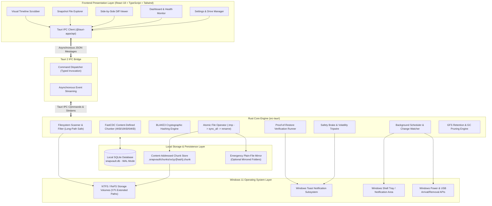
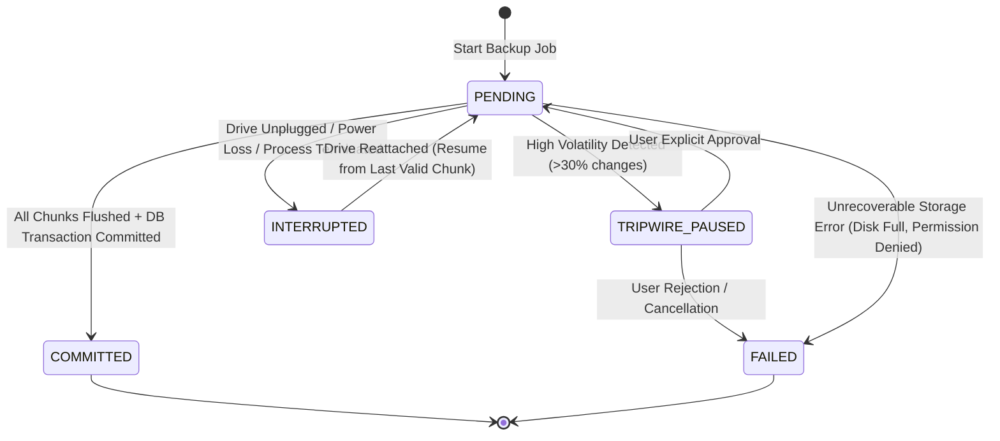
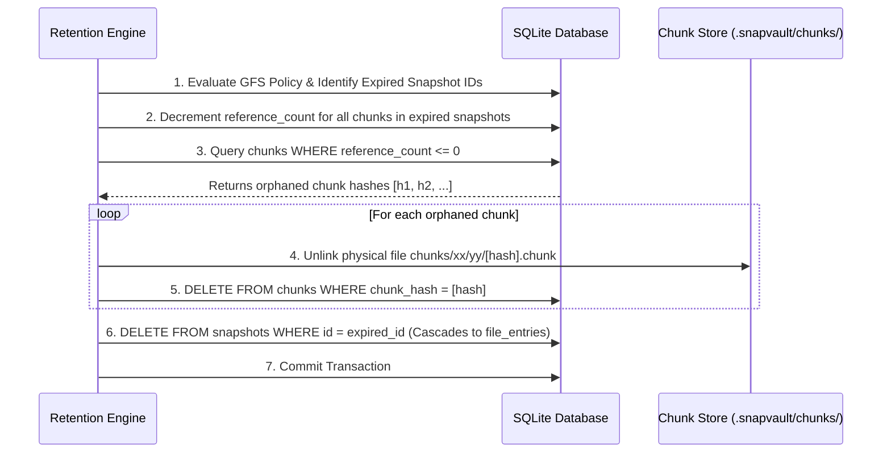
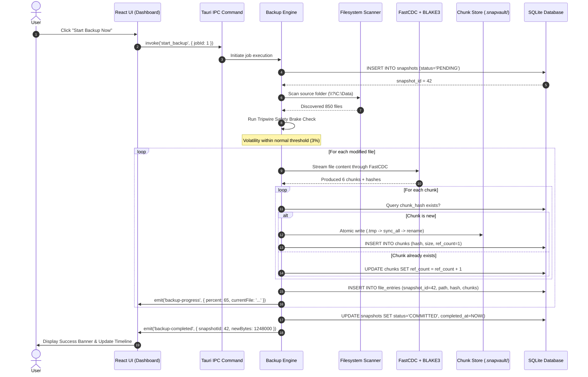
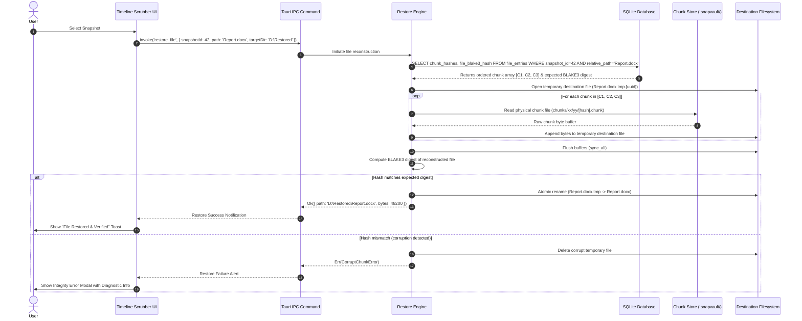
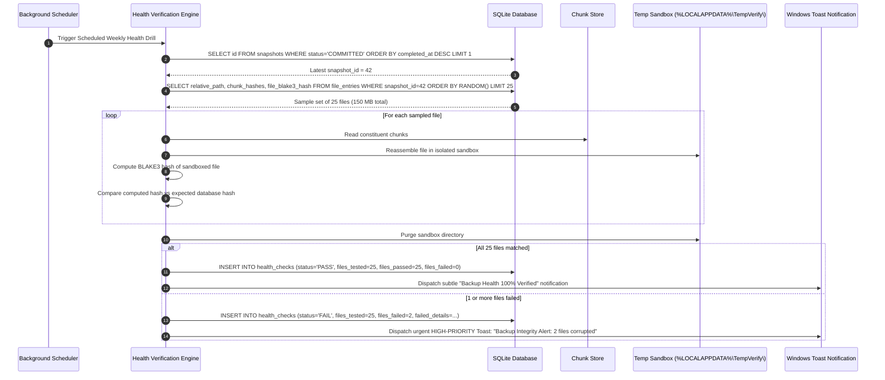

# SnapVault — System Architecture Specification

> **Status:** Approved Baseline  
> **Version:** 1.0.0  
> **Target Platform:** Windows 11 Desktop (Tauri 2 + MSVC x64/ARM64)  
> **Storage Engine:** Local SQLite (WAL Mode) + Content-Addressed BLAKE3 Chunk Store  
> **UI Layer:** React 18 + TypeScript + Tailwind CSS (Vite Bundler + WebView2)  

---

## 1. High-Level System Architecture

SnapVault employs a strict layered architecture designed for local-first execution, zero-network security, and crash-resilient data integrity. The frontend communicates with the native Rust core exclusively via Tauri 2 asynchronous Inter-Process Communication (IPC).



### Architectural Principles
1. **Unidirectional Control Flow:** React emits declarative requests via typed IPC commands (`invoke('create_backup', { ... })`). Rust processes work asynchronously and streams telemetry back via Tauri event channels (`app.emit('backup-progress', payload)`).
2. **Crash-Safe Isolation:** The Rust engine never assumes external storage remains connected. All I/O is wrapped in recoverable `Result<T, SnapVaultError>` types; crashes in the web view cannot corrupt the physical backup store.
3. **100% Offline Integrity:** The network stack is completely absent from the production build. Zero HTTP clients, zero outbound socket libraries, zero analytics SDKs.

---

## 2. Repository & Source Directory Structure

The repository is organized cleanly into the frontend React application, the native Tauri Rust backend, and standardized project governance documentation:

```
snapvault/
├── .github/                       # CI/CD workflows and issue templates
├── .gitignore                     # Git exclusion rules (Node, Rust, SQLite, OS)
├── DEVELOPER.md                   # Mandatory operating protocol and multi-agent roles
├── BRIEF.md                       # Product brief and feature specifications
├── ARCHITECTURE.md                # System architecture, schemas, and data flows (this file)
├── PLAN.md                        # Phase 0 through Phase 6 execution plan
├── ROADMAP.md                     # Living milestone and task tracker
├── ISSUES.md                      # Defect and risk tracking log
├── README.md                      # Project overview and local development instructions
├── package.json                   # Frontend dependencies, scripts, and build metadata
├── tsconfig.json                  # TypeScript compiler configuration (strict mode)
├── vite.config.ts                 # Vite bundler configuration
├── tailwind.config.ts             # Tailwind CSS theme configuration (Windows 11 Fluent)
├── postcss.config.js              # PostCSS plugin configuration
│
├── reports/                       # Formal phase and audit reports
│   ├── REPORT_TEMPLATE.md         # Standardized phase completion report template
│   └── PHASE_0_REPORT.md          # Phase 0 initialization verification report
│
├── src/                           # Frontend React 18 Application
│   ├── main.tsx                   # Application bootstrap and React root mount
│   ├── App.tsx                    # Shell layout, navigation bar, and router
│   ├── index.css                  # Global styles, Fluent UI tokens, Tailwind imports
│   ├── components/                # Reusable UI components
│   │   ├── common/                # Buttons, modals, cards, badges, progress bars
│   │   ├── Timeline/              # Visual Time Machine scrubber and calendar ticks
│   │   ├── FileExplorer/          # Hierarchical folder tree and item list
│   │   ├── DiffViewer/            # Side-by-side text diff and image overlay slider
│   │   ├── DriveManager/          # Source/destination pairing cards and wizard
│   │   └── Health/                # Proof-of-restore cards and verification logs
│   ├── pages/                     # High-level route views
│   │   ├── Dashboard.tsx          # Main overview, latest snapshot status, quick actions
│   │   ├── TimelineView.tsx       # Fullscreen Time Machine browsing and restore view
│   │   ├── BackupJobs.tsx         # Job configuration and manual trigger controls
│   │   ├── HealthAudit.tsx        # Proof-of-restore report history and drill runner
│   │   └── Settings.tsx           # Retention policies, tripwire thresholds, trial info
│   ├── hooks/                     # Custom React hooks
│   │   ├── useBackupProgress.ts   # Subscribes to real-time backup progress events
│   │   ├── useSnapshotTree.ts     # Fetches and caches snapshot file hierarchies
│   │   ├── useDriveStatus.ts      # Tracks drive attachment, space, and availability
│   │   └── useHealthChecks.ts     # Queries health verification drill records
│   ├── types/                     # TypeScript type definitions (mirrors Rust IPC structs)
│   │   ├── ipc.ts                 # Command parameter and return type contracts
│   │   ├── models.ts              # Drive, Job, Snapshot, and FileEntry models
│   │   └── events.ts              # Progress, alert, and notification event payloads
│   └── lib/                       # Utility libraries
│       ├── ipc.ts                 # Type-safe Tauri invoke wrapper functions
│       ├── formatters.ts          # Byte size, relative time, and duration formatters
│       └── constants.ts           # UI constants, route paths, default settings
│
└── src-tauri/                     # Native Rust Core (Tauri 2 Desktop Backend)
    ├── Cargo.toml                 # Cargo package manifest and crate dependencies
    ├── Cargo.lock                 # Deterministic dependency lockfile
    ├── tauri.conf.json            # Tauri runtime, window, permission, and bundle config
    ├── build.rs                   # Tauri build script
    ├── icons/                     # Application icons (ICO, PNG, 32x32 to 512x512)
    └── src/
        ├── main.rs                # Native entrypoint: runs Tauri application
        ├── lib.rs                 # Library root: initializes plugins, DB, and state
        ├── error.rs               # Unified SnapVault error enum and Result aliases
        │
        ├── db/                    # SQLite Database Management
        │   ├── mod.rs             # Database module interface and connection pool setup
        │   ├── schema.rs          # SQL schema migrations (v1 to latest)
        │   ├── models.rs          # Strongly typed Rust structs for database entities
        │   └── queries.rs         # Prepared SQL queries with batched transaction helpers
        │
        ├── engine/                # Core Backup, Restore & Storage Logic
        │   ├── mod.rs             # Engine orchestration interface
        │   ├── chunker.rs         # FastCDC content-defined chunking implementation
        │   ├── hasher.rs          # BLAKE3 streaming hasher and chunk digest generation
        │   ├── store.rs           # Content-addressed chunk store (2-level fan-out)
        │   ├── atomic.rs          # Atomic write coordinator (.tmp -> sync_all -> rename)
        │   ├── scanner.rs         # Recursive directory scanner with long-path support
        │   ├── snapshot.rs        # Snapshot creation, state machine, and commit lifecycle
        │   ├── restore.rs         # Chunk reassembly, byte verification, and file restore
        │   ├── retention.rs       # Grandfather-Father-Son (GFS) pruning evaluator
        │   ├── gc.rs              # Unreferenced chunk garbage collector
        │   ├── tripwire.rs        # Ransomware and mass-deletion volatility safety brake
        │   ├── health.rs          # Automated weekly Proof-of-Restore verification drill
        │   └── mirror.rs          # Plain-file Emergency Mirror mode synchronizer
        │
        ├── commands/              # Tauri IPC Command Handlers
        │   ├── mod.rs             # Command registration handler
        │   ├── backup.rs          # start_backup, cancel_backup, get_backup_status
        │   ├── restore.rs         # restore_file, restore_folder, export_snapshot
        │   ├── snapshots.rs       # list_snapshots, get_snapshot_tree, get_file_diff
        │   ├── drives.rs          # list_drives, pair_drives, check_drive_health
        │   └── settings.rs        # get_settings, update_settings, get_trial_status
        │
        ├── watcher/               # Filesystem Change Detection
        │   ├── mod.rs             # Watcher manager
        │   └── fs_watcher.rs      # Windows directory watcher with buffer overflow recovery
        │
        ├── platform/              # Windows 11 Native Integrations
        │   ├── mod.rs             # Platform integration entrypoint
        │   ├── paths.rs           # Windows \\?\ extended-length path normalizer
        │   ├── tray.rs            # Windows Notification Area icon and context menu
        │   ├── notify.rs          # Native Windows 11 toast notification dispatcher
        │   └── power.rs           # Windows power state and device arrival monitor
        │
        └── licensing/             # Local Trial & Store License Verification
            ├── mod.rs             # Licensing module interface
            └── trial.rs           # Local 14-day trial verification & restore guarantee
```

---

## 3. SQLite Database Schema Specification

The database is stored locally in the application data directory:  
`%LOCALAPPDATA%\SnapVault\snapvault.db`

The database runs in **Write-Ahead Logging (WAL)** mode with `synchronous = NORMAL` and `foreign_keys = ON`. All entity tables, column definitions, constraints, and performance indices are formally specified below:

```sql
-- Pragmas applied on connection initialization
PRAGMA journal_mode = WAL;
PRAGMA synchronous = NORMAL;
PRAGMA foreign_keys = ON;
PRAGMA busy_timeout = 5000;

-- -----------------------------------------------------------------------------
-- Table 1: drives
-- Represents physical or logical storage volumes (sources and backup targets)
-- -----------------------------------------------------------------------------
CREATE TABLE IF NOT EXISTS drives (
    id              INTEGER PRIMARY KEY AUTOINCREMENT,
    uuid            TEXT NOT NULL UNIQUE,          -- Windows Volume GUID or stable ID
    label           TEXT NOT NULL,                 -- User-friendly volume label
    mount_path      TEXT NOT NULL,                 -- Windows drive letter or UNC root (e.g., "D:\")
    role            TEXT NOT NULL CHECK(role IN ('source', 'destination')),
    filesystem      TEXT NOT NULL DEFAULT 'NTFS',  -- NTFS, ReFS, exFAT, etc.
    total_bytes     INTEGER NOT NULL DEFAULT 0,
    free_bytes      INTEGER NOT NULL DEFAULT 0,
    is_active       INTEGER NOT NULL DEFAULT 1 CHECK(is_active IN (0, 1)),
    last_seen_at    TEXT NOT NULL,                 -- ISO 8601 UTC timestamp
    created_at      TEXT NOT NULL DEFAULT (strftime('%Y-%m-%dT%H:%M:%fZ', 'now'))
);

CREATE INDEX IF NOT EXISTS idx_drives_uuid ON drives(uuid);
CREATE INDEX IF NOT EXISTS idx_drives_role ON drives(role);

-- -----------------------------------------------------------------------------
-- Table 2: backup_jobs
-- Associates a watched source folder/drive with one or more destination targets
-- -----------------------------------------------------------------------------
CREATE TABLE IF NOT EXISTS backup_jobs (
    id                  INTEGER PRIMARY KEY AUTOINCREMENT,
    name                TEXT NOT NULL,
    source_path         TEXT NOT NULL,             -- Normalized root directory (e.g., "\\?\C:\Work")
    destination_drive_id INTEGER NOT NULL REFERENCES drives(id) ON DELETE RESTRICT,
    schedule_type       TEXT NOT NULL DEFAULT 'interval' 
                        CHECK(schedule_type IN ('continuous', 'interval', 'daily', 'manual')),
    interval_minutes    INTEGER NOT NULL DEFAULT 60,
    is_active           INTEGER NOT NULL DEFAULT 1 CHECK(is_active IN (0, 1)),
    enable_emergency_mirror INTEGER NOT NULL DEFAULT 0 CHECK(enable_emergency_mirror IN (0, 1)),
    last_run_at         TEXT,                      -- ISO 8601 UTC timestamp
    next_run_at         TEXT,                      -- ISO 8601 UTC timestamp
    created_at          TEXT NOT NULL DEFAULT (strftime('%Y-%m-%dT%H:%M:%fZ', 'now'))
);

CREATE INDEX IF NOT EXISTS idx_backup_jobs_active ON backup_jobs(is_active);
CREATE INDEX IF NOT EXISTS idx_backup_jobs_dest ON backup_jobs(destination_drive_id);

-- -----------------------------------------------------------------------------
-- Table 3: snapshots
-- Represents an immutable point-in-time state of a backup job
-- -----------------------------------------------------------------------------
CREATE TABLE IF NOT EXISTS snapshots (
    id                  INTEGER PRIMARY KEY AUTOINCREMENT,
    job_id              INTEGER NOT NULL REFERENCES backup_jobs(id) ON DELETE CASCADE,
    status              TEXT NOT NULL CHECK(status IN ('PENDING', 'COMMITTED', 'INTERRUPTED', 'FAILED', 'TRIPWIRE_PAUSED')),
    started_at          TEXT NOT NULL,             -- ISO 8601 UTC
    completed_at        TEXT,                      -- ISO 8601 UTC (NULL until COMMITTED)
    total_files         INTEGER NOT NULL DEFAULT 0,
    total_bytes         INTEGER NOT NULL DEFAULT 0,
    new_chunks_count    INTEGER NOT NULL DEFAULT 0,
    new_bytes_stored    INTEGER NOT NULL DEFAULT 0, -- Storage consumed after deduplication
    files_modified      INTEGER NOT NULL DEFAULT 0,
    files_deleted       INTEGER NOT NULL DEFAULT 0,
    tripwire_triggered  INTEGER NOT NULL DEFAULT 0 CHECK(tripwire_triggered IN (0, 1)),
    error_message       TEXT
);

CREATE INDEX IF NOT EXISTS idx_snapshots_job_started ON snapshots(job_id, started_at DESC);
CREATE INDEX IF NOT EXISTS idx_snapshots_status ON snapshots(status);

-- -----------------------------------------------------------------------------
-- Table 4: file_entries
-- Maps every file path in a snapshot to its size, timestamp, and chunk list
-- -----------------------------------------------------------------------------
CREATE TABLE IF NOT EXISTS file_entries (
    id                  INTEGER PRIMARY KEY AUTOINCREMENT,
    snapshot_id         INTEGER NOT NULL REFERENCES snapshots(id) ON DELETE CASCADE,
    relative_path       TEXT NOT NULL,             -- Relative to backup job source root
    file_size           INTEGER NOT NULL,
    modified_at         TEXT NOT NULL,             -- File system mtime ISO 8601
    file_blake3_hash    TEXT NOT NULL,             -- Full file BLAKE3 digest (64 hex characters)
    chunk_hashes        TEXT NOT NULL,             -- JSON array of chunk BLAKE3 hashes in order
    is_deleted          INTEGER NOT NULL DEFAULT 0 CHECK(is_deleted IN (0, 1))
);

CREATE INDEX IF NOT EXISTS idx_file_entries_snapshot_path ON file_entries(snapshot_id, relative_path);
CREATE INDEX IF NOT EXISTS idx_file_entries_hash ON file_entries(file_blake3_hash);

-- -----------------------------------------------------------------------------
-- Table 5: chunks
-- Global index of content-addressed chunks stored on physical media
-- -----------------------------------------------------------------------------
CREATE TABLE IF NOT EXISTS chunks (
    chunk_hash          TEXT PRIMARY KEY,          -- BLAKE3 hash (64 hex characters)
    size_bytes          INTEGER NOT NULL,
    reference_count     INTEGER NOT NULL DEFAULT 1, -- Active file entries referencing this chunk
    first_seen_at       TEXT NOT NULL DEFAULT (strftime('%Y-%m-%dT%H:%M:%fZ', 'now'))
);

CREATE INDEX IF NOT EXISTS idx_chunks_refcount ON chunks(reference_count);

-- -----------------------------------------------------------------------------
-- Table 6: health_checks
-- Audit trail of automated weekly Proof-of-Restore verification drills
-- -----------------------------------------------------------------------------
CREATE TABLE IF NOT EXISTS health_checks (
    id                  INTEGER PRIMARY KEY AUTOINCREMENT,
    job_id              INTEGER NOT NULL REFERENCES backup_jobs(id) ON DELETE CASCADE,
    snapshot_id         INTEGER NOT NULL REFERENCES snapshots(id) ON DELETE CASCADE,
    ran_at              TEXT NOT NULL DEFAULT (strftime('%Y-%m-%dT%H:%M:%fZ', 'now')),
    files_tested        INTEGER NOT NULL,
    bytes_tested        INTEGER NOT NULL,
    files_passed        INTEGER NOT NULL,
    files_failed        INTEGER NOT NULL,
    failed_details      TEXT,                      -- JSON array of { path, expected_hash, actual_hash, error }
    duration_ms         INTEGER NOT NULL,
    status              TEXT NOT NULL CHECK(status IN ('PASS', 'DEGRADED', 'FAIL'))
);

CREATE INDEX IF NOT EXISTS idx_health_checks_ran ON health_checks(job_id, ran_at DESC);
```

---

## 4. Chunking, Hashing & Content-Addressed Store

### 4.1 FastCDC Content-Defined Chunking Pipeline
SnapVault splits files using the FastCDC (Fast Content-Defined Chunking) algorithm rather than fixed-size blocks. Content-defined boundary markers guarantee that insertions or deletions only shift the boundaries of immediate adjacent chunks, preserving deduplication across the rest of the file.

- **Minimum Chunk Size:** 4,096 bytes ($4\text{ KiB}$) — prevents overhead on small files.
- **Average Chunk Size:** 16,384 bytes ($16\text{ KiB}$) — optimal balance between metadata storage and deduplication ratio.
- **Maximum Chunk Size:** 65,536 bytes ($64\text{ KiB}$) — caps memory buffers during streaming.

```text
Input File Stream ───► FastCDC Window Evaluator ───► Split on Rolling Hash Boundary
                              │
             ┌────────────────┼────────────────┐
             ▼                ▼                ▼
        Chunk A (18 KB)  Chunk B (12 KB)  Chunk C (24 KB)
             │                │                │
             ▼                ▼                ▼
        BLAKE3 Hash      BLAKE3 Hash      BLAKE3 Hash
             │                │                │
             ▼                ▼                ▼
        Check SQLite     Check SQLite     Check SQLite
       (Exists? Skip)   (New? Store)     (Exists? Skip)
```

### 4.2 Two-Level Directory Fan-Out Storage
To prevent NTFS filesystem slowdowns caused by storing hundreds of thousands of files in a single folder, chunks are distributed across a **two-level hierarchical directory fan-out** using the first 4 characters of the hex-encoded BLAKE3 digest:

$$\text{Digest: } \mathbf{a3f9}b2c810de\dots$$
$$\text{Storage Path: } \texttt{.snapvault/chunks/}\mathbf{a3}\texttt{/}\mathbf{f9}\texttt{/}a3f9b2c810de\dots\texttt{.chunk}$$

This limits the maximum entries in any single directory to $256$, ensuring rapid directory lookups and constant-time file opens on all storage formats (NTFS, ReFS, exFAT).

---

## 5. Atomic Commit Lifecycle & State Machine

SnapVault enforces a strict atomic commit lifecycle to guarantee that hardware disconnects, unexpected power loss, or OS crashes never corrupt the backup catalog or the chunk store.

### 5.1 Snapshot State Machine



### 5.2 Atomic Write Sequence
Every chunk and metadata entry adheres to the following four-step atomic execution sequence:

1. **Staging Write:** The chunk data is written to a temporary sibling file in the destination store:  
   `chunks/a3/f9/a3f9b2...chunk.tmp.[uuid]`
2. **Hardware Flush:** The engine calls `std::fs::File::sync_all()` (invoking `FlushFileBuffers` on Windows). This forces physical write-back from operating system disk caches to non-volatile media.
3. **Atomic Rename:** The temporary file is renamed to its final immutable content-addressed path:  
   `chunks/a3/f9/a3f9b2...chunk`  
   Under NTFS and Win32 `SetFileInformationByHandle` with `FILE_RENAME_FLAG_REPLACE_IF_EXISTS`, this operation is guaranteed atomic.
4. **Transactional Database Commit:** File entries and chunk references are committed in SQLite within an explicit `BEGIN IMMEDIATE ... COMMIT` block. If the connection fails before the database commits, the snapshot remains in `INTERRUPTED` state; orphaned `.tmp` files are swept on the next connection.

---

## 6. Grandfather-Father-Son (GFS) Retention & Garbage Collection

To prevent backup destinations from filling up over time, SnapVault executes a GFS retention review immediately following every successful snapshot commit:

### 6.1 Pruning Policy Hierarchy
- **Hourly Tier:** Keep 1 snapshot per hour for the past **24 hours**.
- **Daily Tier:** Keep 1 snapshot per day for the past **30 days**.
- **Weekly Tier:** Keep 1 snapshot per week **indefinitely** (or until user-specified maximum disk quota is reached).
- Any snapshot not falling into one of these retention buckets is marked for pruning.

### 6.2 Chunk Reference Counting & Garbage Collection (GC)
Pruning a snapshot does not immediately delete chunks on disk, as other snapshots may depend on identical deduplicated data blocks.



---

## 7. End-to-End Data Flow Diagrams

### 7.1 Backup Creation Sequence



### 7.2 File Restore Sequence



### 7.3 Proof-of-Restore Health Drill Sequence



---
*Document approved for SnapVault Engineering Implementation.*
