# SnapVault — Detailed Phase Execution Plan (Phases 0–6)

> **Document Version:** 1.0.0  
> **Target Release:** v1.0.0 Microsoft Store ($19.99, 14-day trial)  
> **Governance:** Governed by `DEVELOPER.md` (Mandatory Operating Protocol)  
> **Tracking:** Synchronized with `ROADMAP.md` and `ISSUES.md`  

---

## Plan Overview & Phase Roadmap

SnapVault is executed across seven sequential phases (Phase 0 through Phase 6). In accordance with `DEVELOPER.md`, each subtask within a phase is subject to the **Task QA Verify → Fix → Recheck loop**, and every phase concludes with **Central Tester end-of-phase verification** and an official completion report.

```
┌─────────────────────────────────────────────────────────────────────────────┐
│                       SNAPVAULT EXECUTION ROADMAP                           │
├───────────────┬─────────────────────────────────────────────┬───────────────┤
│ Phase 0       │ Project Initialization & Governance Suite   │ Current       │
├───────────────┼─────────────────────────────────────────────┼───────────────┤
│ Phase 1       │ Tauri 2 Scaffold & SQLite Database Core     │ Milestone 1   │
├───────────────┼─────────────────────────────────────────────┼───────────────┤
│ Phase 2       │ Backup Engine Core (FastCDC, BLAKE3, Dedup) │ Milestone 2   │
├───────────────┼─────────────────────────────────────────────┼───────────────┤
│ Phase 3       │ Visual Timeline UI & Instant Restore Engine │ Milestone 3   │
├───────────────┼─────────────────────────────────────────────┼───────────────┤
│ Phase 4       │ The 4 Killer Features (Guard, Tripwire, etc)│ Milestone 4   │
├───────────────┼─────────────────────────────────────────────┼───────────────┤
│ Phase 5       │ Tray Daemon, Scheduler, Retention & Polish  │ Milestone 5   │
├───────────────┼─────────────────────────────────────────────┼───────────────┤
│ Phase 6       │ MSIX Packaging, WACK & Microsoft Store      │ v1.0 Launch   │
└───────────────┴─────────────────────────────────────────────┴───────────────┘
```

---

## Phase 0: Project Initialization & Governance Suite

**Primary Goal:** Verify the Windows development environment, initialize Git repository controls, and establish the complete executive-grade documentation suite.

- **Status:** In Progress (Concluding)
- **Estimated Effort:** 1 prompt
- **Prerequisites / Dependencies:** None

### Phase 0 Deliverables
1. **Environment Verification:** Comprehensive checks for Node.js (v20+), npm, Rust toolchain (`rustc`, `cargo`, `clippy`), Tauri 2 CLI, Windows MSVC Build Tools / linker, WebView2 runtime, and `winapp` CLI.
2. **Version Control Setup:** `git init` on `main` branch with production-grade `.gitignore` covering Node, Rust, Tauri, SQLite, and test stores.
3. **Executive Governance Suite:**
   - `DEVELOPER.md`: Mandatory multi-agent team roles, per-task QA loop, non-negotiable engineering standards.
   - `BRIEF.md`: Vision, user personas, core features, 4 killer features, monetization model, competitive matrix.
   - `ARCHITECTURE.md`: High-level diagrams, directory tree, full SQLite schema, FastCDC chunking, atomic commit lifecycle, GFS retention, data flow diagrams.
   - `PLAN.md`: Detailed Phase 0 through Phase 6 execution plan with measurable acceptance criteria (this document).
   - `ROADMAP.md`: Living task and milestone checkbox tracker.
   - `ISSUES.md`: Structured defect and risk tracking matrix.
   - `README.md`: Professional project readme with local build instructions.
   - `reports/REPORT_TEMPLATE.md`: Standardized phase completion report template.
4. **Phase 0 Completion Report:** `reports/PHASE_0_REPORT.md` documenting environmental findings, issues logged, and verification evidence.

### Phase 0 Acceptance Criteria
- [x] Node.js verified >= v20.0.0 (Actual: v24.12.0)
- [x] npm verified (Actual: v11.6.2)
- [x] Rust toolchain verified (Actual: rustc 1.99.1, cargo 1.99.1, clippy 0.1.99)
- [x] Tauri 2 CLI verified (Actual: tauri-cli 2.12.6)
- [x] WebView2 runtime verified (Actual: 157.0.4341.60)
- [x] Missing MSVC Build Tools identified, tested, and recorded in `ISSUES.md` (ISS-001, ISS-002) with exact install commands
- [x] Optional `winapp` CLI status recorded in `ISSUES.md` (ISS-003)
- [x] Git repository initialized on `main` branch with comprehensive `.gitignore`
- [x] All 8 governance documents created with zero placeholder text
- [x] Cross-references between documents verified for 100% consistency
- [x] `reports/PHASE_0_REPORT.md` generated and reviewed

---

## Phase 1: Tauri 2 Scaffold & SQLite Foundation

**Primary Goal:** Scaffold the Tauri 2 desktop application with React 18, TypeScript, Vite, and Tailwind CSS, and implement the local SQLite database layer with connection pooling, migrations, and model structs.

- **Status:** Pending
- **Estimated Effort:** 1–2 prompts
- **Prerequisites / Dependencies:** Phase 0 complete; Visual Studio C++ Build Tools installed (ISS-001 resolved); Rust default toolchain switched to MSVC (ISS-002 resolved).

### Phase 1 Deliverables
1. **Frontend Project Scaffold:**
   - Initialize Vite + React 18 + TypeScript in workspace root.
   - Configure Tailwind CSS with Windows 11 Fluent Design color tokens, mica effect simulation, and typography.
   - Setup ESLint, Prettier, and TypeScript strict compiler options (`noImplicitAny`, `strictNullChecks`).
2. **Tauri 2 Backend Scaffold:**
   - Configure `src-tauri/Cargo.toml` with dependencies: `tauri`, `tauri-build`, `rusqlite` (bundled), `r2d2`, `r2d2_sqlite`, `serde`, `serde_json`, `thiserror`, `tracing`.
   - Setup `tauri.conf.json` with desktop window specifications (1200x800 minimum, transparent/mica styling, system tray support).
3. **SQLite Database Engine:**
   - Implement connection pool manager in `src-tauri/src/db/mod.rs` using `r2d2_sqlite`.
   - Implement migration runner in `src-tauri/src/db/schema.rs` applying WAL mode pragmas and creating all 6 tables (`drives`, `backup_jobs`, `snapshots`, `file_entries`, `chunks`, `health_checks`).
   - Implement strongly typed domain models in `src-tauri/src/db/models.rs`.
   - Implement database health check and basic query helpers in `src-tauri/src/db/queries.rs`.
4. **Tauri IPC Command Handlers:**
   - Create `get_app_info` command returning app version, platform, and database connection status.
   - Create `get_db_stats` command returning table row counts and database file size.
5. **Basic Frontend UI Shell:**
   - Render application shell with Windows 11 titlebar, sidebar navigation, and dashboard placeholder showing live database connectivity badge.

### Phase 1 Acceptance Criteria
- [ ] `cargo check --target x86_64-pc-windows-msvc` executes with 0 errors
- [ ] `cargo test` executes with all unit tests passing (minimum 5 database migration and model tests)
- [ ] `cargo clippy -- -D warnings` executes with 0 warnings
- [ ] `npm run build` generates production frontend assets without TypeScript errors
- [ ] Application launches in development mode (`npm run tauri dev`) and renders the React interface
- [ ] SQLite database file created on launch at `%LOCALAPPDATA%\SnapVault\snapvault.db`
- [ ] WAL mode verified (`PRAGMA journal_mode` returns `wal`)
- [ ] All 6 tables verified present with correct schemas via automated test
- [ ] Task QA verification loop executed and logged for every subtask
- [ ] Central Tester end-of-phase verification passed; `reports/PHASE_1_REPORT.md` generated

---

## Phase 2: Backup Engine Core (FastCDC, BLAKE3, Dedup)

**Primary Goal:** Build the high-performance Rust backup engine featuring FastCDC chunking, BLAKE3 content-addressed hashing, atomic file staging, deduplication, and snapshot lifecycle state management.

- **Status:** Pending
- **Estimated Effort:** 2–3 prompts
- **Prerequisites / Dependencies:** Phase 1 complete.

### Phase 2 Deliverables
1. **Chunking & Hashing Engine (`src-tauri/src/engine/`):**
   - Implement FastCDC content-defined chunking (`chunker.rs`) with 4 KB min, 16 KB avg, 64 KB max boundaries.
   - Implement BLAKE3 streaming hasher (`hasher.rs`) computing cryptographic chunk digests and full-file hashes.
   - Unit tests validating deterministic chunk boundaries against known test vectors.
2. **Content-Addressed Storage & Atomic Engine:**
   - Implement two-level directory fan-out store (`store.rs`) under `.snapvault/chunks/xx/yy/[hash].chunk`.
   - Implement atomic write operator (`atomic.rs`) enforcing `.tmp.[uuid]` -> `sync_all` -> `rename` pattern.
   - Implement failure recovery cleaner that purges uncommitted `.tmp` files.
3. **Filesystem Scanner & Filter:**
   - Implement recursive directory scanner (`scanner.rs`) with Windows extended-length path (`\\?\`) normalization.
   - Robust Unicode handling (non-ASCII, CJK, emoji, RTL).
   - Ignore pattern evaluator (respecting `.gitignore` and default exclusions like `$RECYCLE.BIN`, `System Volume Information`, pagefile/swapfile).
   - Non-panicking I/O error handler for locked files (log warning and proceed).
4. **Snapshot & Job Pipeline (`snapshot.rs`):**
   - Implement snapshot state transitions (`PENDING` -> `COMMITTED` / `INTERRUPTED` / `FAILED`).
   - Batch insert file entries and chunk records within SQLite transactions (1,000 items per batch).
   - Implement progress reporting channel streaming real-time statistics to the frontend.
5. **IPC Commands & Drive Pairing:**
   - Tauri commands: `pair_drive`, `list_jobs`, `create_backup_job`, `start_backup`, `cancel_backup`.

### Phase 2 Acceptance Criteria
- [ ] FastCDC chunker produces identical chunk boundaries for identical file content
- [ ] BLAKE3 hashing throughput exceeds 1.5 GB/s on benchmark files
- [ ] Atomic writes guarantee no zero-byte or corrupt chunks survive simulated power interruption
- [ ] Deduplication ratio > 0 demonstrated when backing up duplicate or modified files
- [ ] Snapshot status machine prevents illegal state transitions (e.g., cannot commit an interrupted snapshot)
- [ ] Paths exceeding 260 characters backed up and restored without Win32 `MAX_PATH` errors
- [ ] Locked files (e.g., opened in Word) logged gracefully without terminating the backup run
- [ ] At least 25 unit and integration tests passing in `cargo test`
- [ ] Zero clippy warnings under `cargo clippy -- -D warnings`
- [ ] Task QA loop passed on all subtasks; Central Tester sign-off; `reports/PHASE_2_REPORT.md` generated

---

## Phase 3: Visual Timeline UI & Instant Restore Engine

**Primary Goal:** Implement the visual Time Machine timeline scrubber in React and the high-speed file and folder restore engine in Rust with full byte verification.

- **Status:** Pending
- **Estimated Effort:** 2–3 prompts
- **Prerequisites / Dependencies:** Phase 2 complete.

### Phase 3 Deliverables
1. **Restore Engine (`src-tauri/src/engine/restore.rs`):**
   - Implement single-file reconstruction from chunk sequences.
   - Implement recursive directory restore preserving directory structure and file timestamps.
   - End-to-end BLAKE3 verification: compute hash of reassembled file and compare against database record before renaming into place.
   - Safe in-place restore with confirmation modal vs. export to alternate target directory.
2. **Visual Timeline Scrubber Component (`src/components/Timeline/`):**
   - Horizontal, interactive timeline bar with zoom controls (Hours, Days, Weeks, Months).
   - Fluid scrubbing physics with snapping to snapshot ticks.
   - Visual badges distinguishing regular snapshots, daily milestones, and automated health checks.
3. **Snapshot File Explorer (`src/components/FileExplorer/`):**
   - Hierarchical folder navigation tree and file list mirroring historical snapshot state.
   - Clear visual indicators for deleted files (visible in past snapshots with "Deleted" tag).
   - Search and filter bar for finding historical files by name or extension.
4. **Side-by-Side Diff & Preview Engine (`src/components/DiffViewer/`):**
   - Visual side-by-side text diff for code, configuration, and plain text files.
   - Image comparison slider (split overlay) for PNG, JPG, WEBP, and BMP files.
   - File metadata inspector (size diff, modification date, hash comparison).
5. **IPC Wiring & State Management:**
   - React hooks (`useTimeline`, `useSnapshotTree`, `useRestore`) wired to typed Tauri commands.

### Phase 3 Acceptance Criteria
- [ ] Restored files verified 100% byte-for-byte identical to original source files via BLAKE3 hash
- [ ] Restore rejects uncommitted snapshots (`INTERRUPTED`, `FAILED`) with clear error message
- [ ] Timeline scrubber smoothly scrolls across 1,000+ historical snapshots without UI lag (> 60 fps)
- [ ] File explorer renders snapshot directory hierarchy correctly
- [ ] Deleted files appear with proper visual badges in historical views and can be restored
- [ ] Diff viewer correctly displays line additions, deletions, and modifications
- [ ] Image comparison slider functions smoothly for supported graphic formats
- [ ] At least 15 frontend unit/component tests passing via Vitest / React Testing Library
- [ ] Full backend regression test suite passing with zero clippy warnings
- [ ] Task QA loop passed on all subtasks; Central Tester sign-off; `reports/PHASE_3_REPORT.md` generated

---

## Phase 4: The 4 Killer Features

**Primary Goal:** Build the four gap-closing killer features that differentiate SnapVault: Silent-Failure Guard, Unplug-Safe Engine, Ransomware Safety Brake, and Multi-Drive Rotation with Emergency Plain-File Mirror.

- **Status:** Pending
- **Estimated Effort:** 2–3 prompts
- **Prerequisites / Dependencies:** Phase 3 complete.

### Phase 4 Deliverables
1. **Silent-Failure Guard & Automated Weekly Proof-of-Restore (`health.rs`):**
   - Background drill runner that pseudorandomly selects 25–50 files from the latest snapshot.
   - Reassembles files in an isolated sandbox (`%LOCALAPPDATA%\SnapVault\TempVerify\`).
   - Verifies BLAKE3 hash of every restored file; logs results to `health_checks` table.
   - Dispatches Windows 11 toast notification upon completion (subtle success vs. high-priority alert on failure).
   - Frontend Health Audit page showing historical drill results and one-click manual test button.
2. **Unplug-Safe Atomic Engine Disconnect & Resume (`atomic.rs`):**
   - Windows device arrival/removal event listener detecting USB disconnects.
   - Graceful transition to `INTERRUPTED` on disconnect without data corruption.
   - Automatic resumption upon drive reconnection, picking up from the last uncommitted chunk.
3. **Ransomware & Mass-Deletion Tripwire Safety Brake (`tripwire.rs`):**
   - Pre-commit volatility heuristic calculating percentage of changed/deleted files.
   - Triggers `TRIPWIRE_PAUSED` state if changes exceed 30% or 500 files.
   - Prominent UI alert modal requiring user review and explicit override or cancellation.
4. **Multi-Drive Rotation & Plain-File Emergency Mirror Mode (`mirror.rs`):**
   - Support pairing multiple destination drives to a single backup job with independent volume tracking.
   - Emergency Mirror Mode: synchronizes designated critical folders to standard, unchunked plain Windows directories on the backup drive.

### Phase 4 Acceptance Criteria
- [ ] Proof-of-Restore drill successfully runs, verifies test files, and writes audit record to `health_checks` table
- [ ] Intentionally corrupted chunk detected by health drill, logging `FAIL` and triggering warning toast
- [ ] Abrupt USB disconnect during active backup leaves database and chunk store clean (state = `INTERRUPTED`)
- [ ] Reconnecting drive allows seamless resumption without re-chunking previously stored files
- [ ] Tripwire halts backup when test batch of >30% modified files is introduced, requiring user confirmation
- [ ] Multi-drive rotation operates seamlessly when alternate paired drive is connected
- [ ] Emergency Mirror directory on target drive contains plain readable files accessible without SnapVault
- [ ] Full suite of unit and integration tests for all 4 killer features passing
- [ ] Zero warnings under `cargo clippy -- -D warnings` and `npm run lint`
- [ ] Task QA loop passed on all subtasks; Central Tester sign-off; `reports/PHASE_4_REPORT.md` generated

---

## Phase 5: System Tray, Scheduler, Retention & Polish

**Primary Goal:** Implement the background tray daemon, continuous and cron-based scheduling, GFS retention pruning with chunk garbage collection, local-only 14-day trial licensing, and Windows 11 accessibility polish.

- **Status:** Pending
- **Estimated Effort:** 1–2 prompts
- **Prerequisites / Dependencies:** Phase 4 complete.

### Phase 5 Deliverables
1. **Windows System Tray Daemon (`src-tauri/src/platform/tray.rs`):**
   - Lightweight background tray icon with dynamic status badges (idle checkmark, backing up spinner, warning alert).
   - Tray context menu: Open SnapVault, Pause Backups (1h / 4h / until tomorrow), Run Backup Now, Check Health, Exit.
   - Minimize-to-tray and close-to-tray behavior.
2. **Background Scheduler & Filesystem Watcher (`watcher/`):**
   - Continuous watching using `notify` crate with periodic reconciliation scans (mitigating RISK-003).
   - Configurable interval scheduler (every 15m, 30m, 1h, daily).
   - Power state awareness (pauses backups on battery saver or low battery).
3. **GFS Retention Policy & Chunk Garbage Collector (`retention.rs`, `gc.rs`):**
   - Automatic post-backup evaluation of hourly (24h), daily (30d), and weekly retention buckets.
   - Decrement chunk reference counts and unlink unreferenced chunk files from disk.
4. **Local-Only 14-Day Trial & Licensing (`licensing/trial.rs`):**
   - Cryptographically signed local trial installation timestamp.
   - Trial status display in UI (days remaining; gentle reminder on day 12+).
   - Post-trial enforcement: snapshot creation disabled; **ALL restore and visual browsing capabilities remain permanently active and free**.
5. **Accessibility & Fluent UI Polish Pass:**
   - Full keyboard navigation (Tab, Arrow keys, Enter, Escape).
   - Windows High-Contrast Mode compatibility and screen reader ARIA labels.
   - Cold start optimization ensuring application launches in under 2.5 seconds.

### Phase 5 Acceptance Criteria
- [ ] Tray icon reflects live status and responds instantly to context menu commands
- [ ] Scheduled backups trigger reliably on configured cron and interval schedules
- [ ] Continuous watcher captures new and modified files within 60 seconds
- [ ] GFS retention prunes expired snapshots according to 24h / 30d / weekly rules
- [ ] Garbage collector purges unreferenced chunks and reclaims physical disk space
- [ ] Trial countdown displays accurate day count; expires cleanly after 14 days
- [ ] Expired trial permits 100% of restore operations while blocking new snapshot creation
- [ ] Cold launch time < 2.5 seconds; idle RAM consumption < 60 MB in tray mode
- [ ] All accessibility audits pass with zero WCAG 2.1 AA violations
- [ ] Task QA loop passed on all subtasks; Central Tester sign-off; `reports/PHASE_5_REPORT.md` generated

---

## Phase 6: Microsoft Store Packaging & Launch (v1.0.0)

**Primary Goal:** Build the production MSIX package, verify Windows App Certification Kit (WACK) compliance, conduct security and privacy audits, prepare store assets, and finalize the v1.0.0 release.

- **Status:** Pending
- **Estimated Effort:** 1–2 prompts
- **Prerequisites / Dependencies:** Phase 5 complete; Windows SDK / packaging tools installed.

### Phase 6 Deliverables
1. **MSIX Package Generation:**
   - Configure Tauri 2 Windows bundler (`tauri.conf.json`) for MSIX output.
   - Setup Windows App Manifest (`AppxManifest.xml`) with capabilities, file associations, and background task declarations.
   - Sign package with development certificate for local side-loading verification.
2. **Windows App Certification Kit (WACK) Audit:**
   - Execute automated WACK test suite against the generated MSIX package.
   - Resolve any package compliance warnings or crashes.
3. **Zero-Telemetry & Offline Security Audit:**
   - Monitor application runtime with Wireshark and `netstat` across all user workflows.
   - Confirm 0 outbound DNS queries, 0 HTTP requests, and 0 external socket connections.
4. **Performance & Stress Profiling:**
   - Benchmark memory and CPU utilization during 50 GB initial backup and 1,000-snapshot repository.
   - Verify memory ceiling: < 150 MB idle, < 500 MB under heavy FastCDC chunking load.
5. **Microsoft Store Listing & Documentation:**
   - Store description, bulleted feature list, search keywords, and support links.
   - High-resolution visual assets: 1:1 application icon (512x512), promotional banners, and screenshot showcase.
   - Store-compliant Privacy Policy explicitly declaring zero data collection and 100% local operation.
6. **Release Tagging & Final Artifacts:**
   - Git tag `v1.0.0` with signed release commit.
   - Standalone open-source restore tool specification documented.

### Phase 6 Acceptance Criteria
- [ ] MSIX package installs cleanly on a fresh Windows 11 installation
- [ ] Windows App Certification Kit (WACK) passes with zero errors and zero warnings
- [ ] Zero outbound network connections confirmed via packet capture during active backup, restore, and idle states
- [ ] Peak RAM usage remains below 500 MB during intensive 50 GB backup job
- [ ] Clean uninstallation verified with no orphaned background services or registry keys
- [ ] Store listing assets and privacy policy approved
- [ ] Complete end-to-end regression test suite passing across all Phase 1–5 features
- [ ] Phase 6 Central Tester sign-off; `reports/PHASE_6_REPORT.md` generated; v1.0.0 declared READY FOR LAUNCH

---

## Dependencies & Phase Progression Matrix

The following matrix defines the mandatory prerequisite chain between phases. No phase may commence until its predecessor phase has achieved a signed `PASS` completion report from the Central Tester.

```mermaid
graph LR
    P0[Phase 0:\nInitialization & Docs] -->|PASS Report| P1[Phase 1:\nTauri 2 & SQLite]
    P1 -->|PASS Report| P2[Phase 2:\nBackup Engine Core]
    P2 -->|PASS Report| P3[Phase 3:\nTimeline UI & Restore]
    P3 -->|PASS Report| P4[Phase 4:\nThe 4 Killer Features]
    P4 -->|PASS Report| P5[Phase 5:\nTray, Scheduler & Polish]
    P5 -->|PASS Report| P6[Phase 6:\nStore Packaging & Launch]
```



---
*Execution plan approved for SnapVault Engineering Team. Governed by DEVELOPER.md.*
